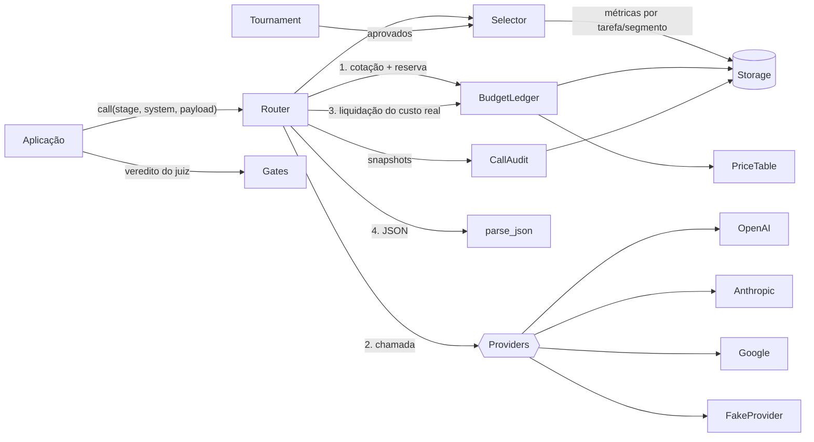

# llm-router

Roteador de chamadas a LLMs com orçamento reservado antes de pagar, verificação por um provedor independente, trilha de auditoria e um seletor que aprende qual modelo usar em cada tarefa.


Este código foi extraído e generalizado da camada de roteamento de um pipeline de notícias em produção que construí: um sistema que extrai fatos, escreve textos, verifica o que escreveu e publica todos os dias em vários idiomas, com OpenAI, Anthropic e Google. Aqui ficaram só as partes reutilizáveis. Não há prompts, fontes nem regras editoriais.

## Que problema resolve

Quando um sistema faz milhares de chamadas a LLMs por dia, os problemas deixam de ser de prompt e passam a ser de operação:

- **Provedores falham.** Faltam créditos, chegam erros 5xx, a chave expira. Sem uma cadeia de reserva, o pipeline para.
- **Quem escreve não pode se corrigir.** Se o mesmo provedor gera e julga o texto, os mesmos vieses passam pelos dois lados.
- **O custo foge do controle depois de pago.** Um teto checado *depois* da chamada só avisa que o dinheiro já foi gasto.
- **Escolher o modelo "no olho" envelhece rápido.** Preços e qualidade mudam todo mês, e o modelo mais caro nem sempre é o melhor para a tarefa.
- **Uma nota alta do juiz convence.** Um 95 parece seguro, mas não deveria aprovar um texto que é uma recusa do modelo ou que contém um problema grave apontado pelo próprio juiz.

## Arquitetura



Fluxo de uma chamada:

1. O `Router` pega a cadeia da etapa (`extract`, `synthesize`, `verify`, `summarize`...) e, se houver `Selector`, deixa ele reordenar.
2. Para cada rota (`provedor/modelo`) e tentativa: cota o pior caso na `PriceTable`, **reserva** no `BudgetLedger`, chama o provedor, **liquida** o custo real pelos tokens e faz o parse do JSON.
3. Erro do provedor ou JSON inválido: espera (backoff linear) e tenta de novo. Depois de `retries` tentativas, passa para a próxima rota.
4. A cada mudança de estado, grava um snapshot de auditoria (só metadados, nunca prompts nem respostas).

## Decisões de projeto e por quê

### Verificador independente
A etapa de verificação exige `exclude_provider`. O `router.verify(resultado, ...)` já passa o provedor e o modelo que escreveram o texto. Se só sobrar o mesmo provedor, a chamada **falha fechada** por padrão. O modo degradado (mesmo provedor, outro modelo) existe, mas é opcional (`allow_degraded_verification=True`) e vem marcado como `degraded=True` no resultado e no log. Em produção, a verificação chegou a rodar degradada sem ninguém perceber, porque a chave do terceiro provedor estava vazia. Daí a regra: a independência tem que ser visível, não presumida.

### Reservar antes de pagar
O teto diário (global e por etapa) é verificado com o **pior caso** da próxima chamada *antes* de ela acontecer: entrada limitada pelo tamanho em bytes (um limite superior seguro para tokenizadores BPE, sem precisar de tokenizador) mais `max_tokens` de saída. A reserva é gravada numa transação (`BEGIN IMMEDIATE` no SQLite), então dois processos não passam juntos pela mesma folga. Depois da chamada, o custo real substitui a reserva. Regras que vieram da produção:

- **Exceção do provedor não prova que não houve cobrança.** A reserva fica aberta e a chamada aparece como `reconciliation_required` até alguém conciliar com a fatura (`ledger.reconcile`, que exige evidência).
- **Resposta paga com custo desconhecido não é repetida.** Se o JSON veio inválido e o uso de tokens não veio, o router para, em vez de pagar de novo às cegas.
- **Custo acima do reservado congela o dia.** Significa que a tabela de preços ou o adaptador está errado. Nada novo é reservado até um operador corrigir e chamar `unfreeze`.
- **Cada custo é gravado uma vez só.** A chave de idempotência é o id da reserva.
- **Dinheiro é `Decimal` arredondado para cima.** Valor `float` é recusado.

### Gates acima da nota do juiz
`apply_gates` roda checagens determinísticas **antes** do limiar de nota: veredito inválido, recusa do modelo no lugar da resposta, tema sensível sem fonte primária, fontes em conflito e problema de gravidade alta listado pelo próprio juiz. Se algum dispara, a nota não importa. No seletor vale o mesmo princípio: um modelo desabilitado, fora do idioma, acima do teto de custo ou abaixo do piso de qualidade em pedido sensível não entra no ranking, por melhor que seja a recompensa medida. E um modelo reprovado em 70% ou mais de pelo menos 30 peças vai para o fim da cadeia. São regras em código puro: testáveis sem rede e iguais em toda execução.

### Exploração
O `Selector` ordena os modelos pela recompensa (qualidade do juiz + percentil de engajamento, que só conta depois de a peça amadurecer). Duas regras completam o ranking:

- **O mais barato vence se a qualidade estiver a até 5 pontos do melhor.** O preço é o efetivo: preço por tentativa dividido pela taxa de aprovação. Assim, um modelo que é muito reprovado custa o que custa de verdade.
- **Uma parte das chamadas explora outros candidatos:** 15% normalmente, 30% enquanto algum candidato tiver menos de 15 amostras (e aí o sorteio prefere os "frios").

Sem exploração, o primeiro modelo a ir bem nunca mais perde a vaga, e um modelo novo e mais barato nunca tem chance. O `rng` é injetável, então os testes são determinísticos.

### Torneio offline
As estatísticas de produção têm viés: cada modelo viu entradas diferentes, em dias diferentes. O `Tournament` dá **as mesmas entradas** a todos os modelos, com rota forçada (sem fallback, para que a falha conte contra quem falhou), e um juiz pontua tudo com a mesma rubrica. Só os aprovados (amostras mínimas, nota acima do piso e a até 15 pontos do melhor) disputam em produção. Um torneio com mais de 14 dias deixa de valer.

### Armazenamento plugável
A interface `Storage` tem duas implementações: `InMemoryStorage` (testes, demos, jobs de um processo) e `SQLiteStorage` (durável, vários processos no mesmo host). Para PostgreSQL ou Redis, basta implementar os mesmos métodos com `transaction()` serializando escritas (`SELECT ... FOR UPDATE`, por exemplo).

## Como rodar

```bash
python3 -m venv .venv
source .venv/bin/activate
pip install -e ".[dev]"

python examples/demo.py   # ponta a ponta com FakeProvider, sem chaves
pytest                    # 58 testes
ruff check .
```

Para usar provedores reais, instale os extras e defina as chaves **só como variáveis de ambiente** (`OPENAI_API_KEY`, `ANTHROPIC_API_KEY`, `GOOGLE_API_KEY`):

```bash
pip install -e ".[openai,anthropic,google]"
```

```python
from decimal import Decimal
from llm_router import RouterConfig, Stage, PriceTable, build_router
from llm_router.providers import OpenAIProvider, AnthropicProvider, GoogleProvider

config = RouterConfig(
    chains={
        Stage.SYNTHESIZE: ["anthropic/<modelo>", "openai/<modelo>", "google/<modelo>"],
        Stage.VERIFY: ["openai/<modelo>", "google/<modelo>", "anthropic/<modelo>"],
    },
    daily_budget_usd=Decimal("20"),
    stage_budgets_usd={"verify": Decimal("5")},
)
prices = PriceTable.from_json(open("prices.json").read())  # sua tabela, conferida nos sites oficiais
router = build_router(config, {"openai": OpenAIProvider(), "anthropic": AnthropicProvider(),
                               "google": GoogleProvider()}, prices=prices)

draft = router.call(Stage.SYNTHESIZE, "Responda em JSON.", {"facts": [...]})
verdict = router.verify(draft, "Avalie o texto. Responda em JSON.", {"draft": draft.data})
```

> **Preços:** `example_price_table()` usa IDs de modelo fictícios e preços **ilustrativos**. Não são preços oficiais de nenhum provedor. Antes de usar em produção, monte sua própria tabela com os preços atuais.

## Estrutura

```
llm-router/
├── src/llm_router/
│   ├── router.py        # ponto único de chamada: cadeias, independência, retries, reserva, auditoria
│   ├── budget.py        # BudgetLedger: reservar, liquidar, conciliar, congelar
│   ├── pricing.py       # PriceTable versionada, cotação do pior caso, Decimal
│   ├── selector.py      # Selector: recompensa, regra do mais barato, exploração, travas
│   ├── gates.py         # checagens determinísticas acima da nota do juiz
│   ├── tournament.py    # comparação offline com as mesmas entradas
│   ├── audit.py         # snapshots de auditoria por chamada (sem prompts)
│   ├── storage.py       # interface + InMemoryStorage + SQLiteStorage
│   ├── parsing.py       # extração tolerante de JSON
│   ├── config.py        # RouterConfig, Stage, Route
│   ├── errors.py
│   └── providers/       # OpenAI, Anthropic, Google, FakeProvider
├── tests/               # pytest, sem rede
├── examples/demo.py
└── .github/workflows/ci.yml
```

## Autor

**Rafael Lins Gaspar**. [rafaellinsrj.github.io](https://rafaellinsrj.github.io) · [linspartners.com](https://linspartners.com)

Licença MIT.

---

## English summary

**llm-router** is a budget-aware, auditable LLM router extracted and generalized from a production news pipeline the author built. One `call(stage, ...)` runs a per-stage chain of `provider/model` routes with retries and linear backoff, then falls back to the next route.

Key design decisions:

- **Independent verifier.** A verify stage never runs on the provider that wrote the text it judges. Degraded mode is opt-in and flagged.
- **Reserve before paying.** The worst-case cost is reserved atomically against global and per-stage daily ceilings before any paid call, then settled with the real token usage. Uncertain charges stay reserved until a human reconciles them with evidence. Each cost is recorded exactly once.
- **Deterministic gates above the judge score.** A refusal, a high-severity issue, or a sensitive claim without a primary source blocks the output no matter how high the score is. In the selector, the same principle applies through eligibility gates and a rejection lock.
- **Exploration.** The selector ranks models by reward (judge quality plus engagement percentile). The cheapest model wins when quality is within 5 points of the best, and price is adjusted by the approval rate. 15% of calls explore other candidates, or 30% while some candidate has fewer than 15 samples.
- **Offline tournament.** All models get the same inputs with a forced route. Only approved models compete in production.

Run `pip install -e ".[dev]" && python examples/demo.py && pytest`. The example prices are illustrative placeholders, not official provider prices. MIT licensed. © 2026 Rafael Lins Gaspar.
